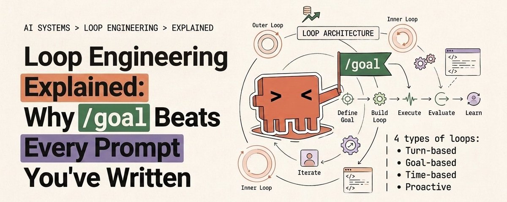
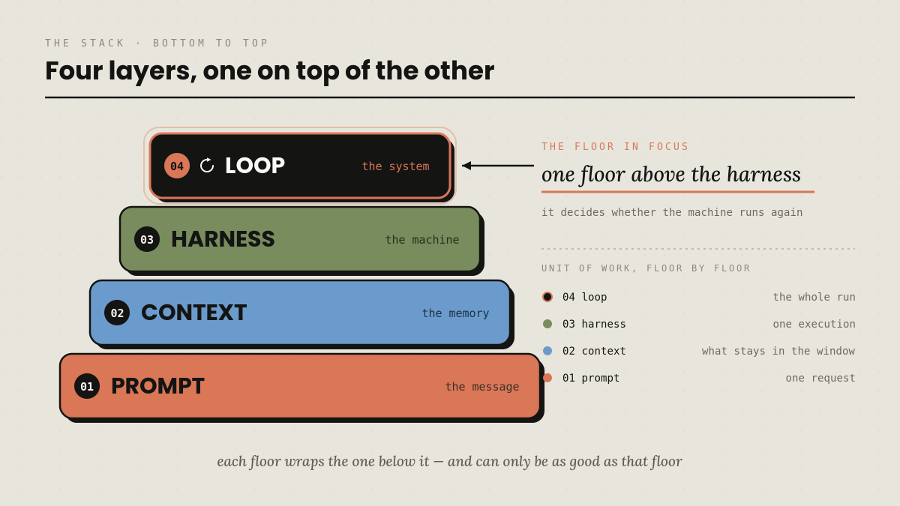
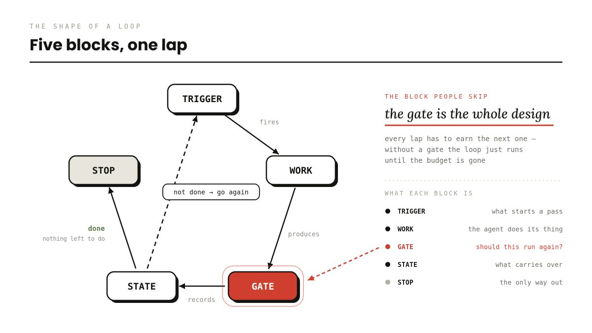
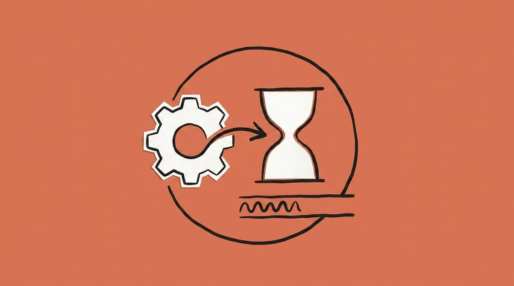
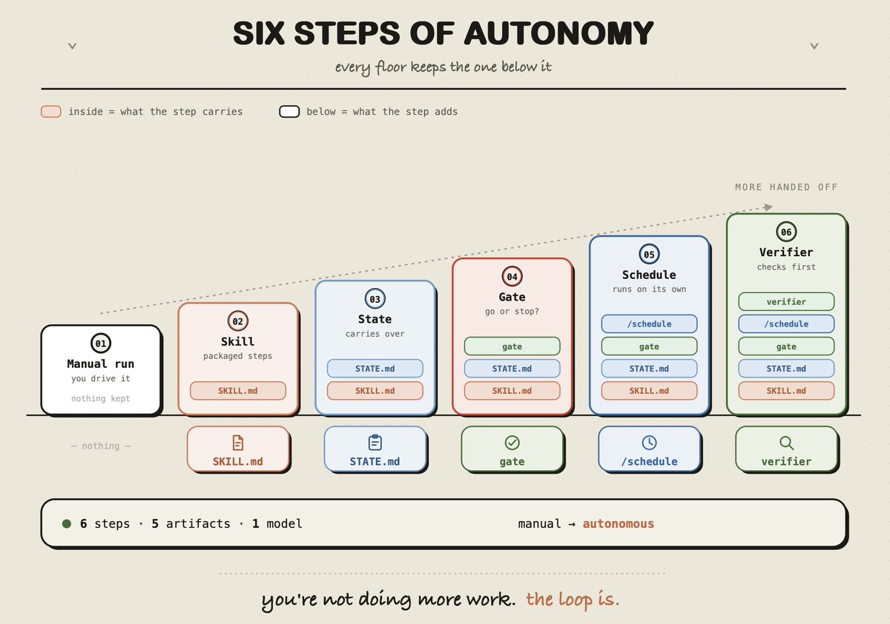
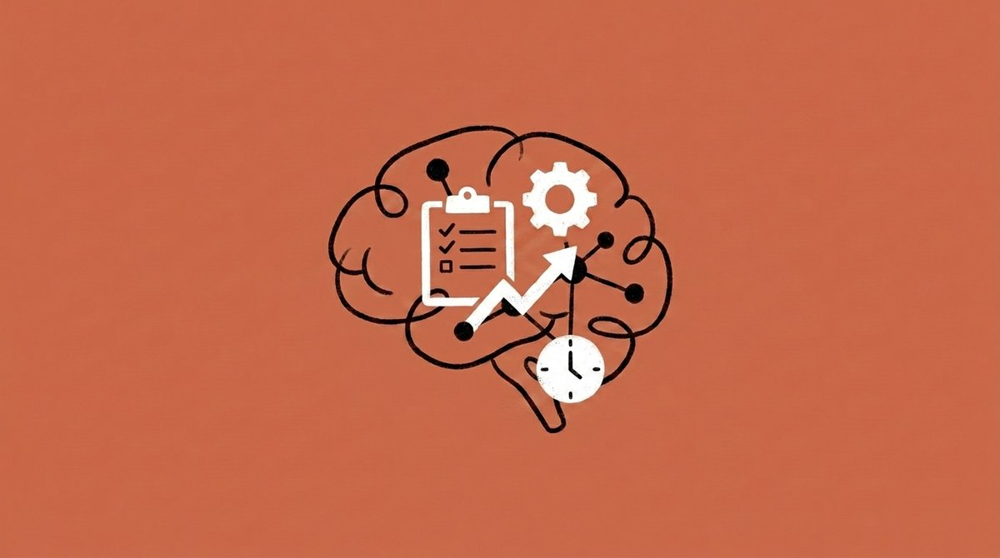
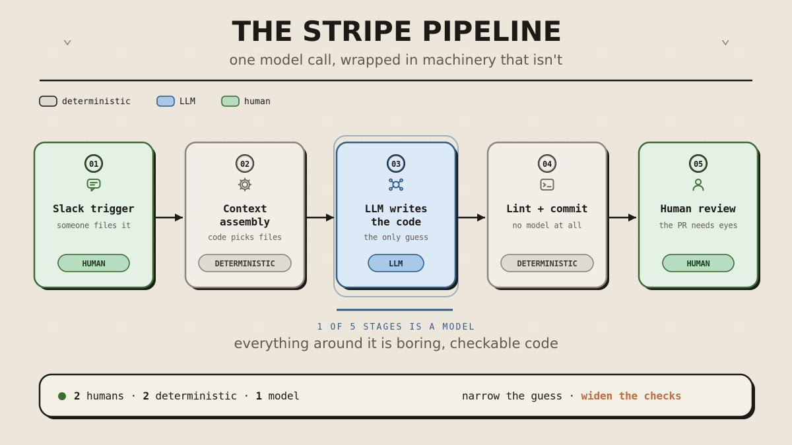
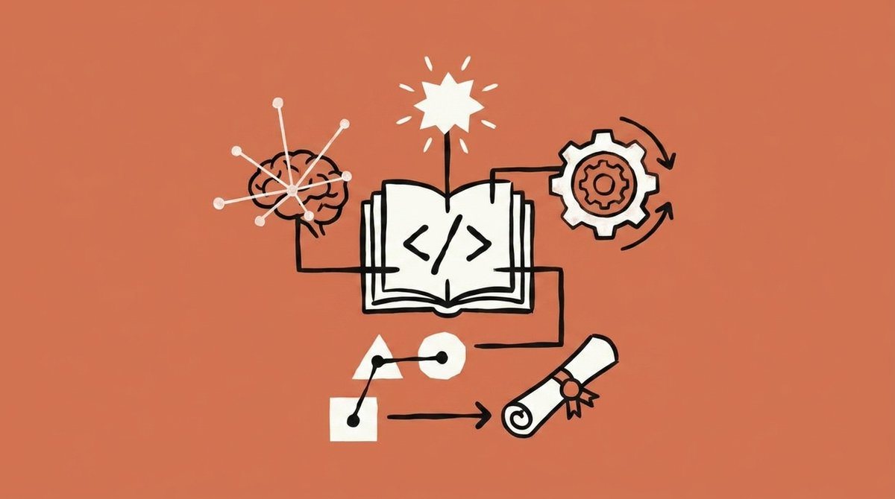
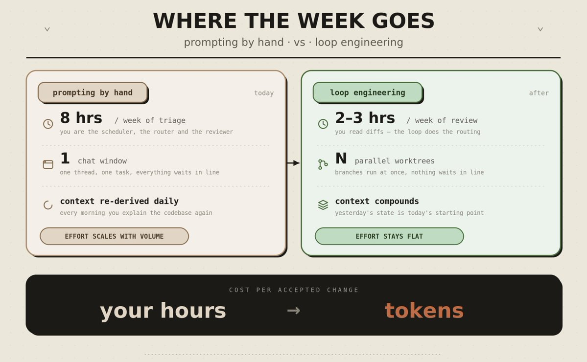

作者：Mr. Buzzoni（[@polydao](https://x.com/polydao)）

[原帖链接](https://x.com/polydao/status/2083061585858158636)



---

**用一段话说明：**循环工程意味着，你不用亲自给智能体写提示词，可以开始构建一个替你向智能体发出提示的系统。

它由触发器启动，在隔离空间中完成工作，由第二个智能体拒绝不合格输出，把发生过的事情写入磁盘，并在第二天从上一次停止的位置继续。

本文会介绍这个想法的来源、Claude Code 中的四类循环、如何按顺序构建第一个循环，以及循环会在你睡觉时以哪四种方式产生账单。

---

## 60 秒了解核心概念

|问题|简短回答|
|---|---|
|什么是循环？|智能体反复执行工作，直到满足停止条件。|
|2026 年改变了什么？|控制点从编写提示词，转移为设计替你编写提示词的系统。|
|什么让循环有效？|闸门：某个能够客观拒绝输出的东西。|
|什么让循环失效？|同一个东西缺失。|
|从哪里开始？|一项重复任务、一个技能、一个状态文件、一道闸门。|
|成本是什么？|难以预测的词元成本，以及必须持续支付的审查时间。|
|谁应跳过它？|任务不会每周重复，或无法自动检查的人。|

---

## 一个起点事实

2026 年 3 月，Andrej Karpathy 向 GitHub 推送了三个文件，总计约 630 行。

一个文件承载模型，一个负责为它评分，一个规定智能体可以修改哪个文件。然后他合上了电脑。


两天后，这个设置已经完成了大约 700 次实验，并找出了 20 项改进，针对的是他亲自调过二十年的一个模型。

其中一项是注意力路径中缺失的一个标量。没有任何 linter 能捕捉它。一位细致的工程师本可以发现它，但二十年来没有人发现。

其中的提示词很普通。真正重要的一切都存在于周围的三个文件中：选择下一个实验、运行它、给它评分、保留改动或回滚，再来一次。

Shopify 的 CEO 也在内部模型上运行过类似的夜间设置，醒来后发现模型质量提升了 19%，而该模型的规模只有原先的一半。

人到第 12 个实验左右就会感到厌倦，循环永远不会。

> 这个术语在一周内出现。_2026 年 6 月，OpenClaw 作者 Peter Steinberger 发帖称，人们应当设计“为智能体写提示词的循环”，而非亲自给智能体写提示词。该帖获得超过 800 万次浏览。同一时期，领导 Anthropic Claude Code 团队的 Boris Cherny 表示，他现在的工作是编写循环来提示 Claude，并让它自己判断下一步做什么。6 月 7 日，Google Chrome 团队工程师 Addy Osmani 将这件事完整写下，并给出了后来被固定下来的名字。_

三个人，一周时间，彼此没有协调。这通常意味着，地面早已移动，只是所有人还站在上面。

与此同时，你的订阅可能只用了 10% 的能力：一个窗口、一项任务、一个人坐在那里等待输出结束。

---

## 1. 循环工程处在什么位置

每隔几个月，总会出现一种“某某工程”，让大家翻白眼。循环工程值得占据一席之地，因为下面四个术语是在逐层叠加，而非相互替代。

|层次|处理的单元|它回答的问题|
|---|---|---|
|提示词工程|一条消息|我该对模型说什么？|
|上下文工程|一个窗口|什么应进入、什么应被概括、什么应被清除？|
|Harness工程|一次运行|使用哪些工具、哪些权限、何时算完成？|
|循环工程|位于运行环境之上的调度|它如何一次又一次自行运行？|

每上升一层，处理单元就变大：一句话、一个窗口、一次运行，然后是一个无需你报时也会持续运行的系统。

前三层都假设你正坐在键盘前指导智能体，第四层移除了这一假设。

区分这些层次有一个实际原因：它们会在不同的时间尺度上失效。糟糕的提示词会在数秒内暴露；糟糕的上下文会体现在答案里；糟糕的运行环境会浪费一次运行；糟糕的循环会在凌晨 3 点修改代码，把错误带进下一次运行，并且一周都无人察觉。

层级越高，你离现场越远，错误在被发现前累积的时间越长。



---

## 2. 一个循环由什么构成

提示词是一份样本，循环是一个控制器。

**去掉术语后，每个有效循环都包含同样的五个部分：**

- **触发器：**什么启动一次运行。你的消息、时钟、事件或 Webhook。没有它，你仍然是那个时钟。
    
- **工作：**智能体收集上下文、采取行动、读取返回结果。
    
- **闸门：**某个没有偏好、却能拒绝输出的东西，例如测试套件、构建、类型检查或静态检查器的退出码。没有它，智能体会在每轮都审查自己，而且极其宽容。
    
- **状态：**对话之外的一个文件，保存已经完成的内容和下一步要做的事。没有它，明天会从零开始。
    
- **停止：**结束运行的条件，以及在该条件永远不出现时的硬上限。没有它，系统会一直花钱，直到有人注意到。
    

**一次真实循环依次经历：**

1. **发现：**确定本次运行应当做什么。
    
2. **交接：**把任务交给独立隔离工作空间中的智能体。
    
3. **验证：**第二个智能体带着不同指令，尝试找出问题。
    
4. **持久化：**结果落到磁盘，而不是留在聊天记录中。
    
5. **调度：**设置下一次运行，并把今天未完成的内容带过去。
    

拿掉其中任意一步，系统要么停滞，要么在计费表持续跳动时原地打转。



---

## 3. Claude Code 中的四类循环

Claude Code 团队按两个问题对循环分类：什么启动一次运行，什么结束一次运行。答案决定了应该使用哪条命令。

|类型|启动时机|结束时机|命令|
|---|---|---|---|
|回合式|你发送提示词|Claude 判断任务已完成|提示词 + 验证技能|
|目标式|你说明完成目标|评估器确认条件成立|`/goal`|
|时间式|一个时间间隔过去|你取消它，或工作完成|`/loop`、`/schedule`|
|主动式|事件或计划触发，无人看守|每项任务在达成目标时退出|上述全部 + 工作流 + 自动模式|

### 回合式：改进检查机制

这是你每天已经在运行的普通智能体循环。把验证流程写进 `SKILL.md` 后，它会变得更好：Claude 会像审查者一样检查结果，而不是在成功编辑后就停止。

```markdown
---
name: verify-frontend-change
description: 在声明完成前，对任何 UI 变更进行端到端验证。
---

1. 启动开发服务器，打开已编辑页面。
2. 点击新控件，确认状态变化，并截取操作前后的截图。
3. 检查浏览器控制台：没有新增错误或警告。
4. 运行性能追踪，审查 Core Web Vitals。

若任意步骤失败，修复后从第 1 步重新运行。
```

这些步骤越可衡量，Claude 就越难说服自己过早结束。



  

### 目标式：`/goal`

```text
/goal 将首页 Lighthouse 分数提升到 90 分或以上，最多尝试 5 次后停止。
```

它之所以有效，关键在于由谁决定是否完成。一个小型快速模型会在每轮结束后读取对话记录，回答“是”或“否”，并返回一行理由，作为下一轮的指导。

> _值得了解的规则：每个会话只能有一个目标，新目标会替换旧目标。不带参数的_ _`/goal`_ _会显示回合数、词元数和评估器最近一次给出的理由。__`/goal clear`_ _结束目标。条件最多可写 4,000 个字符；它只能判断 Claude 在对话中呈现出来的内容，因为评估器本身不会运行任何操作。_

因此，**`test/auth`** **中所有测试通过且 lint 步骤干净**，可以在二十轮中稳定成立；而**代码看起来很干净**，第一轮就会崩塌。

  

### 时间式：`/loop` 与 `/schedule`

```text
/loop 5m 检查我的 PR，处理审查意见，并修复失败的 CI。
```

`/loop` 在你的机器上运行。`/schedule` 则把相同形态移到云端，变成合上笔记本也会继续的例行任务。

  

### 主动式：将所有能力叠加

```text
/schedule every hour: 检查 project-feedback 频道中新增的缺陷报告。

/goal: 在本轮发现的每一份报告都已分类、处理并回复前不要停止。修复缺陷时，
在彼此隔离的并行 worktree 中探索三种方案，并让评审模型以对抗方式审查它们。
```

一条命令，四种基本元素：云端触发器、明确的完成终点、隔离的并行工作空间，以及带着新鲜上下文到来的审查者。

⚠️ 有两条命令总被混淆：`/loop` 按定时器重复运行，`/goal` 一直运行到条件成立。调度与停止是两个独立工作，大多数失效循环恰恰把它们混为一谈。

---

## 4. 评估器：所有人都会跳过的部分

构建一个能运行的东西，只是容易的那一半。困难的一半，是在里面放入一个能够说“不”的机制。

Anthropic 工程师 Prithvi Rajasekaran 在构建长时间运行的应用时遇到过这一点：让智能体评估自己产出的工作时，即便人类能看出质量平庸，它仍会充满信心地赞美自己的工作。

> 原因是结构性的，不是智力问题。代码写成时的上下文，塞满了所有支持当初那样写的论据；因此回读时，智能体看到的是自己的推理，而不是结果。写作者也有同样的失败：重读草稿时，你看到的是脑海中的版本。

在循环中，这个问题会不断放大。每一轮由作者自己判定“已经够好”，都是它在同意自己。

Rajasekaran 先尝试了最显而易见的修复方式：迫使生成器更严格地批评自己的输出。结果很糟。他得出的有用结论是：**调好一个独立的怀疑者，远比让作者对自己保持批判容易。**他借鉴了 GAN 的形态：一个网络负责构建，另一个负责挑错。

||装饰性的评估器|真正的评估器|
|---|---|---|
|指令|与生成器相同，再加上“审查它”|独立指令，专门用于寻找问题|
|模型|完全相同|尽量使用不同模型，相同底座会保留相同盲点|
|方法|阅读代码|对代码动手：打开页面、点击、截图、检查 DOM|
|默认立场|信任|在证明无误前，假定它有问题|
|结果|两个乐观者达成一致|循环真的能够说“不”|

Rajasekaran 正是因此把评估器接入 Playwright MCP。判定从“JSX 看起来没问题”变成了“我点击登录，它完成了跳转，这是截图”。

`/goal` 将这件事作为产品原语交付：完成状态由一个从未参与生成工作的全新模型判定。银行几十年来也遵循同样的规则：输入大额转账的人，不能同时是批准它的人。

生成器决定你的循环能够产出什么，评估器决定它拒绝产出什么。


---

## 5. 过滤器：任务本身是否适合做成循环

四个条件必须同时成立，任何一个被破坏，循环带来的成本都会超过收益。

- **任务至少每周重复一次：**检查你的日历，而不是你的意愿。
    
- **有东西能自动拒绝不良输出：**说出会失败的命令，例如 `npm test`、`tsc` 或构建命令。
    
- **词元预算能够承受浪费：**循环会重试、重读和游走，因此要假定有些运行不会交付任何东西。
    
- **智能体拥有资深工程工具：**日志、复现环境、运行自己所写内容并观察其崩溃的能力。
    

最先产生回报的循环往往并不光鲜：CI 失败分流、依赖升级 PR、lint 并修复、复现不稳定测试，以及测试覆盖真实存在的“问题到 PR 草稿”流程。

> 最令人兴奋的那些工作，恰好应保持人工处理：架构重写、认证和支付、生产部署、模糊的产品工作，以及任何“完成”仍需要某个人做出判断的事情。

有一句话值得贴在显示器上：当审查能力已经是你的瓶颈时，循环只会拉长队列，而不会缩短它。

---

## 6. 按顺序构建第一个循环

这里顺序比工具更重要。跳步骤，正是循环在人们睡觉时失控的原因。

1. **让一次人工运行变得可靠。**先用 Claude 手动完成任务，直到结果可重复且无聊。不能自动化无法重复的东西。
    
2. **把这次运行写成一个技能。**记录约定、构建步骤，以及团队一直用来处理某个不稳定运行器的变通办法。让计划任务触发一个具名技能，而不是触发一堵粘贴指令，因为放在 cron 任务里的指令从来不会有人更新。
    
3. **加入状态文件。**在仓库根目录添加 `STATE.md`。纳入版本控制、可阅读差异、保持朴素。
    
4. **给它加上闸门与上限。**一个客观检查加上回合上限。这一步让循环拥有失败的能力。
    
5. **然后再调度它。**仍在看守时使用 `/loop`；只有信任它无人看守时，才使用 `/schedule`。
    
6. **引入验证子智能体。**在 `.claude/agents/` 中放置第二个智能体，使用独立指令，最好换一个模型。
    

```markdown
# 循环状态 · ci-triage

## 上次运行
2026-07-28 03:30 UTC · 已分类 7 个失败，起草 3 个修复，升级 4 个给人工。

## 进行中
- claude/fix-auth-token-refresh - 本地测试通过，等待 CI。

## 已升级给人工
- src/billing/refund.ts - 以三种方式失败，根因不明。

## 经验记录（写在这里，不要写在聊天中）
- 2026-07-27: tests/e2e/checkout 需要 Stripe webhook 密钥。缺失时跳过。
```

记忆会在会话结束时消失，仓库中的文件不会。上下文是智能体在本轮看到的内容；记忆是在窗口被清除后仍保留下来的内容，只有后者真正属于你。

对于长时间运行，将状态文件配合一份固定的 `VISION.md` 使用。`STATE.md` 保存当前位置，`VISION.md` 保存目的地；后者可以在第 47 轮左右阻止目标漂移。

给并行智能体隔离空间：使用 worktree，使两个智能体永远不会写同一个文件。两个智能体编辑同一个文件，就像两个工程师不沟通却向同一行代码推送一样混乱。让构建者快速且便宜地运行，把更慢、更严格的模型交给审查者。



---

## 7. 它究竟在哪里运行

“它在你睡觉时运行”常被随意使用。本地循环会在你合上笔记本的瞬间停止。

||云端例行任务|桌面端计划任务|`/loop`|
|---|---|---|---|
|运行位置|Anthropic 云端|你的机器|你的机器|
|机器必须开机|否|是|是|
|会话必须打开|否|否|是|
|最小间隔|1 小时|1 分钟|1 分钟|
|能看到本地文件|否，使用全新克隆|是|是|

应从任务反向判断。每分钟监控一个本地开发服务器，只能使用 `/loop`；凌晨 3 点扫描未关闭问题并创建 PR，则应交给云端例行任务或计划的 GitHub Action，因为笔记本会被带出家门。

本地调度的含义是“趁我还在这里，多运行几轮”。云端调度的含义是“在我不在时运行”。把二者当成同一件事，正是人们吹嘘的半数循环离开桌面就停止的原因。

底层只是普通 cron：五个字段、最小粒度为一分钟，设置 `CLAUDE_CODE_DISABLE_CRON=1` 可以关闭整套机制。



---

## 8. 两个已经在运行的循环

> 一个人，一个早晨。_Osmani 自己的分流循环在他醒来前启动。一个分流技能会读取昨天的 CI 失败、未关闭问题和最近提交。每一个值得处理的发现，都会在独立 worktree 中打开。_

一个子智能体起草修复，第二个子智能体根据项目测试和技能对它发起攻击。连接器负责打开 PR 并更新工单；任何模糊事项会落进人工收件箱，状态文件将剩余内容带到明天。

整条链路都不需要他亲自动手，却仍会在人类判断开始的地方停下来。

**一家公司，每周 1,300 个 PR。**Stripe 运行着一个名为 Minions 的内部系统，由工程师 Steve Kaliski 公开描述。每周有超过 1,300 个 PR 合入，无需任何人亲手编写代码。你只需在 Slack 中标记机器人，或在一条消息上添加表情，随后就可以忘记它。

有趣的部分发生在模型醒来之前。一个确定性编排器先组装上下文：扫描消息中的链接、拉取 Jira、查找文档，并通过 Sourcegraph 和 MCP 搜索相关代码。

只有在一切都铺开之后，智能体才开始编写。完成后，一条硬编码流水线会运行静态检查器，智能体无法绕过它。

**这里有三点值得借鉴：**

1. **任何规则能够决定的事情，都不要交给概率模型。**查找材料是确定性工作，应由确定性代码完成。
    
2. **可靠性来自约束，而不是模型规模。**Minions 是开源工具 Goose 的一个分支，不是秘密的前沿模型。
    
3. **人类没有离开。**这 1,300 个 PR 仍由工程师审查。他们只是从编写者的桌子，转移到了审查者的桌子。
    



> ⚠️ **关于流传的数字。**“Claude Code 90% 的代码由自身编写”等标题数据，大多是二手信息。Anthropic 自己公布的 8 倍合并率，也附带说明该数值几乎肯定夸大了真实收益。上面的两个案例可追溯到一手来源，因此才值得作为推理基础。

---

## 9. 四笔账

这些成本在循环运行时都不会弹出提醒。

|成本|症状|防护措施|
|---|---|---|
|验证债务|未审查的输出堆积，错误在看不见的地方累积|使用与执行工作的智能体不同的评估器|
|理解力腐蚀|仓库持续增长，你脑中的地图停在原地|每周阅读少量已合入的变更，并向自己解释它们|
|认知让渡|你不再形成判断，只接受返回结果|可以交出执行，但不能交出决策|
|词元失控|花费剧烈波动，账单无法预测|上线前设置单次预算、每日预算与最大重试次数|

**验证债务**是 Ralph Wiggum 循环的所在地，这个称呼来自 Geoffrey Huntley：智能体在任务只完成一半时发出完成信号，运行心满意足地退出。

解法是没有意见的闸门：某个能够编译或失败、返回零或非零的东西。带主观意见的审查者最终会把自己说服为批准。

- **理解力腐蚀**在那个循环修不好的缺陷出现前毫无声响，它埋在你从未打开过的文件中。那天早晨，你会发现自己已经成为项目里的访客。
    
- **认知让渡**是下面两者共同的斜坡。循环越稳定，你越信任它；看得越少，判断能力就越弱。你不必经常推翻它，但必须持续有能力说“这是错的”。
    
- **词元失控**会直接落到账单上。你写下的是逻辑，实际支付的是运行次数乘以单价；一个整夜旋转的缺陷，会变成账单而不是修复。
    

这四项之下还有一个安全维度。生成的代码合入速度比任何人阅读的速度都快，因此应将 SAST、依赖审计和密钥扫描放在闸门内。

自动安装的社区技能会带来描述中包含的一切内容。对 17,022 个技能的一次审计发现，520 个会泄露凭据。长时间运行中的详细日志会把密钥散落到无人查看的日志里。而那次“只加这一次”的写权限，除非你把检查它安排进日历，否则再也不会被审查。

这种方式最有吸引力的地方，是一个人可以完成一个团队的工作。风险也在同一个位置：团队会彼此争论，而一个人加上一组循环，可能变成一间所有人都同意彼此的房间。

---

## 10. 唯一该盯住的指标

**每个被接受变更的成本。**

词元花费、PR 数量和计划循环数看起来都像进展，但没有一个真正衡量进展。如果循环产出的变更中，不足一半能通过审查，你实际上做的是循环本应替你消除的审查工作。

Claude Code 会提供输入：`/usage` 按技能、子智能体和 MCP 拆分近期花费；不带参数的 `/goal` 会报告当前目标的回合数与词元数；`/workflows` 则显示每个智能体的用量，并允许你在运行中终止任意智能体。



---

## 11. 这件事值多少钱

- **合同制搭建工作。**小团队会支付 3,000 至 8,000 美元，请人搭建 CI 分流、依赖自动化和夜间审查循环。内部的每个人都想要它，却没有人能空出一周来做。
    
- **在此基础上的持续服务。**循环运行后，每月 500 至 1,500 美元，用于保持它们的调校。
    
- **你自己的时间。**原本每周吞掉 8 小时的早晨分流，可以降到 2 至 3 小时阅读变更。每周拿回一个完整工作日，价值取决于你一天的成本。
    
- **职位。**年薪 9.5 万美元的开发者，与年薪 30 万美元的 AI 架构师，往往只是同一个人在 18 个月间运行了不同的技术栈。
    
- **入门价格。**第一个循环可以跑在 20 美元订阅上；高强度的夜间验证需要真实预算，CI 分流则不需要。
    

没有卖这件事的人会大声说出的部分是：在消费级套餐上，对严肃工作进行高强度验证时，支出会比回报提前数周出现。

> **为一项重复任务构建一个循环，让结果自己证明预算是否合理。**

生成是循环几乎免费化的部分。代码、计划、PR、修复，都能以接近零的成本批量生产，因此它们不再稀缺。

仍然稀缺的是判断力：知道哪个计划正确、哪个变更应当被停止、哪个输出运行得完美却在根本上是错误的。

循环可以产出一百种选项，甚至可以挑一个，但它挑选的依据是“看上去合理”，而不是“确实正确”。这个差距，正是这份工作仍然存在的全部理由。



---

## 12. 今晚从哪里开始

选出你每天早晨出于习惯都会打开的任务。那个你会对新员工说“这个每天都得看一眼”的任务。

然后判断它的哪一小部分可以最先交出去。

- 能否写下工作如何被检查？那就是一个技能。
    
- 能否精确说明完成状态是什么？那就是一个 `/goal`。
    
- 工作是按时钟到来，而不是由你发起吗？那就是 `/loop`，之后再用 `/schedule`。
    
- 如果以上都还不具备，那么答案就是先完成一次可靠的人工运行。
    

构建第一个循环，观察它在哪里停滞、在哪里越界。收紧它，然后再构建第二个。

两个人可以构建完全相同的循环，六个月后却走向相反的地方。一个人用它更快完成自己已经理解的工作，因此循环放大了他的判断力。

另一个人用它来避免理解任何事情，因此循环也放大了这一点。系统没有偏好，它是一个乘号，而你才是那个被乘的数。

Karpathy 把键盘交给实验循环，两天内找回了二十年来遗漏的改进。构建 Claude Code 的 Cherny 说，他现在的工作是写循环。他们两人依然会为所有重要决定作出判断。

去构建循环。但要以一个打算继续当工程师的人，而不是一个只负责按下开始按钮的人，来构建它。

---

## 用一张表看清该交接什么

|你交出去的内容|对应原语|适用时机|
|---|---|---|
|检查机制|验证技能|你仍在探索或判断时|
|停止条件|`/goal`|你明确知道完成状态是什么时|
|触发器|`/loop`、`/schedule`|工作按计划到来时|
|提示词本身|例行任务 + 工作流 + 自动模式|工作重复且定义清晰时|

---

**资源：**

📁 Claude Code 循环指南 ↳ [claude.com/docs/en/scheduled-tasks](https://code.claude.com/docs/en/scheduled-tasks)

📁 `/goal` 文档 ↳ [claude.com/docs/en/goal](https://code.claude.com/docs/en/goal)

📁 Claude ↳ [claude.ai](https://claude.ai/)

## 如果这篇内容对你有帮助

- 如需每周阅读关于 AI 架构与智能体经济的深度内容，可关注 [@polydao](https://x.com/polydao)。
    
- 加入 Telegram 频道：[Buzzoni Notes](https://t.me/+Wf8q84QkpyJhNjIy)。作者会在这里分享原始提示词、自定义技能，以及尚早于 X 发布的内容。
